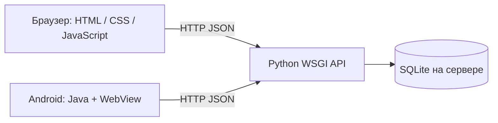
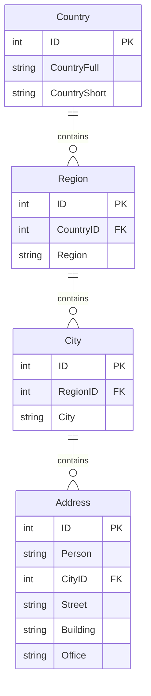

# Информационная подсистема ведения адресов клиентов

Вариант 2. Учебный проект.

## Назначение

Приложение поддерживает в актуальном состоянии адреса клиентов. Пользователь
может добавлять, просматривать, изменять и удалять записи, а также искать данные.
Один интерфейс доступен из браузера компьютера и Android-приложения.

## Архитектура

Сервер принимает запросы, проверяет данные и выполняет SQL-запросы с параметрами.
Клиент не подключается напрямую к базе данных. Android-клиент использует WebView,
чтобы не дублировать формы и логику веб-клиента.

## Модель данных

| Таблица | Поля |
|---|---|
| Country | ID, CountryFull, CountryShort |
| Region | ID, CountryID, Region |
| City | ID, RegionID, City |
| Address | ID, Person, CityID, Street, Building, Office |

В задании название поля дома написано `Bulding`; в реализации использовано
исправленное `Building`. Поле `Person` хранит название или имя клиента, как
предусмотрено схемой варианта. Отдельная таблица клиентов не требуется.

Внешние ключи обеспечивают целостность. Удаление связанных справочных записей
запрещено. Поля проверяются и на клиенте, и на сервере; поле Office необязательное.

## HTTP API

| Метод | Путь | Действие |
|---|---|---|
| GET | /api/health | Проверка сервера и базы |
| GET | /api/snapshot | Согласованный снимок всех четырёх таблиц |
| GET | /api/{entity} | Список записей |
| GET | /api/{entity}/{id} | Одна запись |
| POST | /api/{entity} | Создание |
| PUT | /api/{entity}/{id} | Изменение |
| DELETE | /api/{entity}/{id} | Удаление |
| POST | /api/demo | Учебные примеры для пустой базы |

`entity`: countries, regions, cities, addresses. Формат данных — JSON.
Основные ответы: 200 (успех), 201 (создано), 400 (ошибка данных), 404 (не найдено),
409 (дубликат или связанные записи), 500 (ошибка сервера).

## Проверка работы

Выполнены семь интеграционных тестов с отдельными временными базами:

1. Создание всей цепочки, изменение адреса и удаление в правильном порядке.
2. Проверка обязательных полей, длины строк, дубликатов и внешних ключей.
3. Изменение всех трёх справочников.
4. Сохранение данных при повторной инициализации и необязательный офис.
5. Добавление примеров без перезаписи уже существующих данных.
6. Неверный JSON, тип запроса, размер и запрос с другого сайта.
7. Раздача интерфейса и недоступность файлов сервера и базы по HTTP.

Результат: все 7 тестов пройдены локально и на PythonAnywhere (Python 3.12).
В браузере проверены связанные списки, создание,
редактирование и удаление адреса. Android APK собран командой assembleDebug;
подпись APK проверена apksigner. Проверка установки на физический телефон
в этот отчёт не включена.

Приложение размещено по адресу https://svgagwfaegaswdgaws.pythonanywhere.com.
По внешнему HTTPS-адресу проверены `/api/health`, загрузка интерфейса,
добавление учебных примеров и сохранение изменений адреса.

## Сценарий демонстрации

1. Открыть приложение и показать статус «Сервер доступен».
2. Создать страну, регион и город или добавить учебные примеры в пустой базе.
3. Добавить адрес клиента, выбрав страну, регион и город.
4. Найти клиента поиском, изменить дом или офис.
5. Перезагрузить страницу и показать сохранённые данные.
6. Попробовать удалить занятый город и показать сообщение о связанных записях.
7. Открыть APK с тем же сервером и показать те же данные.
